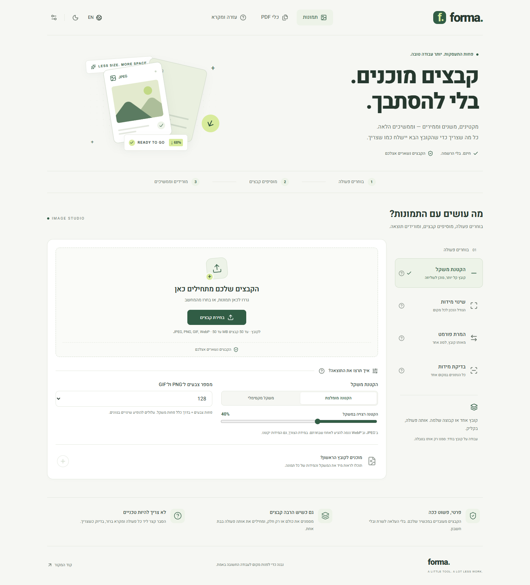

<div dir="rtl">

# FORMA — קבצים מוכנים. בלי להסתבך.

כלי אונליין פשוט לעבודה עם תמונות ו־PDF, בעברית כברירת מחדל, ללא הרשמה וללא העלאת הקבצים לשרת. מתאים גם למי שלא עובד עם תוכנות גרפיות.

**[פתיחת הכלי](https://bigmisha87.github.io/FORMA-TOOL/)** · [העדפות Pages במאגר](https://github.com/bigmisha87/FORMA-TOOL/settings/pages) · [בדיקות ופרסום](https://github.com/bigmisha87/FORMA-TOOL/actions)

**מצב הפרסום:** הפרויקט מוכן. הקישור יתחיל לעבוד לאחר הפעלת GitHub Pages וביצוע הפרסום הראשון.



## מה אפשר לעשות?

| תמונות | PDF |
| --- | --- |
| הקטנת JPEG ו־WebP למשקל יעד ב־KB או באחוזים | שינוי סדר העמודים בגרירה או בחצים |
| הקטנת PNG ו־GIF באמצעות צמצום צבעים | סיבוב, מחיקה ובחירת עמודים |
| שמירת האנימציה, התזמון והלולאה ב־GIF | איחוד כמה מסמכים |
| שינוי מידות ותבניות מוכנות לרשתות, באנרים ומייל | חילוץ עמודים נבחרים למסמך אחד |
| שמירת פרופורציות כברירת מחדל | פיצול לעמודים נפרדים בתוך ZIP |
| המרה בין JPEG, PNG, WebP ו־GIF | דחיסה עדינה השומרת על תוכן המסמך |
| טבלת מידות, משקל וסוג הקובץ + יצוא CSV | דחיסה חזקה באמצעות המרת העמודים לתמונות |
| עבודה על קובץ בודד או קבוצה + הורדת ZIP | יצוא העמודים לתמונות JPEG |
| יצירת PDF מתמונות מסומנות | דחיסת קבוצת מסמכים בנפרד |

הממשק כולל אנגלית, מצב בהיר / כהה / לפי המכשיר, שמירת שפה ותצוגה וטאב פתיחה כברירת מחדל, עמוד עזרה ומקרא, כפתורי עזרה ליד הכלים ו־tooltips לפקודות. ההעדפות נשמרות בדפדפן בלבד. הקבצים עצמם אינם נשמרים בין ביקורים.

## הפעלת האתר ב־GitHub Pages

1. פתחו **Settings → Pages** במאגר.
2. תחת **Build and deployment → Source** בחרו **GitHub Actions**.
3. פתחו **Actions → Test, build and publish FORMA → Run workflow** והפעילו על `main`.
4. לאחר שהשלבים עוברים בהצלחה, פתחו את [הכלי](https://bigmisha87.github.io/FORMA-TOOL/).

ה־workflow לא מפעיל Pages בעצמו. כל עוד Pages כבוי, הוא בודק ובונה את האתר ושומר את תוצר הבנייה. לאחר ההפעלה, דחיפות ל־`main` נבדקות ומתפרסמות אוטומטית. אין צורך במפתח API או בשרת.

## שימוש מהיר

1. בוחרים טאב ופעולה.
2. גוררים קבצים או בוחרים אותם מהמחשב.
3. בודקים את ההגדרות. לתמונה בודדת מתוך קבוצה, מסמנים רק אותה.
4. מכינים את הקבצים ומורידים תוצאה בודדת או ZIP.

המקור נשאר ללא שינוי. הטבלה מראה את המידות והמשקל בפועל, לפני ואחרי. כשדחיסה באותו פורמט יוצרת קובץ גדול יותר, הכלי שומר את המקור.

## דברים שכדאי לדעת

- דחיסה למשקל יעד של JPEG / WebP עשויה להקטין גם את מידות התמונה. אם היעד לא הושג, תופיע הודעה.
- PNG / GIF משתמשים בצמצום צבעים; אחוז החיסכון אינו מובטח וייתכנו שינויי גוונים.
- תבנית עם שמירת פרופורציות היא מסגרת מקסימלית ללא חיתוך; למשל תמונה רחבה בתוך 1080 × 1080 יכולה להסתיים ב־1080 × 540. ניתן לבטל שמירת פרופורציות כדי למתוח למידות הרצויות.
- המרת GIF מונפש לפורמט אחר שומרת את הפריים הראשון. APNG ו־WebP מונפש נדחים במפורש, כדי לא לאבד אנימציה בטעות.
- JPEG אינו תומך בשקיפות. אזורים שקופים מקבלים רקע לבן.
- דחיסת PDF עדינה לא תמיד חוסכת מקום. דחיסה חזקה מבטלת טקסט לבחירה, קישורים וטפסים פעילים משום שהיא הופכת את העמודים לתמונות. אם אין חיסכון, יוחזר המקור.
- כלי סידור ואיחוד ה־PDF מיועדים למסמכים רגילים. שימור טפסים, סימניות וחתימות דיגיטליות אינו מובטח.
- מגבלות: 50 תמונות בקבוצה, 50 MB לתמונה, 32 מיליון פיקסלים ועד 16384 בכל צד. GIF: עד 300 פריימים ועד 80 מיליון פיקסלים במצטבר. PDF: עד 100 MB לקובץ ועד 200 עמודי מקור בסך הכל. PDF מוגן בסיסמה אינו נתמך.
- מומלץ דפדפן מעודכן. עיבוד תמונות רץ ב־Web Worker בדפדפנים עם OffscreenCanvas; קיימת חלופה בדפדפנים ללא התמיכה הזו. PDF.js מצייר את התוכן המקומי באמצעות worker משלו.

## בדיקות ופיתוח

דרוש Node.js 24 ומעלה.

</div>

```sh
npm ci
npm run dev

# Unit tests
npm test

# Install the browser once, then run actual browser/download tests
npx playwright install chrome
npm run test:e2e

# Type-check and production build
npm run build
# Verify the compiled image and PDF workers at the GitHub Pages subpath
npm run test:production
npm run preview

# Optional: Firefox and WebKit as well
npx playwright install firefox webkit
npm run test:browsers
```

<div dir="rtl">

בדיקות הדפדפן פותחות ומפענחות את הקבצים שהורדו, בודקות מספר בתים ומשקל יעד, מידות ופרופורציות, שקיפות, אנימציית GIF, ייחוד שמות בתוך ZIP, נתוני CSV, וסדר / סיבוב / מספר עמודים ב־PDF. בנוסף נבדקים מובייל, עברית / אנגלית, שמירת העדפות, עזרה ושגיאות קלט. פרטי האימות ב־[TESTING.md](TESTING.md).

`npm ci` מעתיק את משאבי PDF.js המקומיים ל־`public/pdfjs`. המשאבים נארזים באתר; לא נדרש CDN חיצוני. הנתיבים בבנייה יחסיים ותומכים בכתובת המשנה של GitHub Pages.

## קוד פתוח

הפרויקט משתמש ב־[pdf-lib](https://pdf-lib.js.org/) (MIT), ב־[Mozilla PDF.js](https://mozilla.github.io/pdf.js/) (Apache-2.0), ב־[UPNG.js](https://github.com/photopea/UPNG.js), ב־[gifuct-js](https://github.com/matt-way/gifuct-js), ב־[gifenc](https://github.com/mattdesl/gifenc) וב־[fflate](https://github.com/101arrowz/fflate) (MIT). רישיונות הספריות והגופן מופיעים ב־[THIRD_PARTY_NOTICES.md](THIRD_PARTY_NOTICES.md) ובמשאבי PDF.js הנלווים.

</div>
