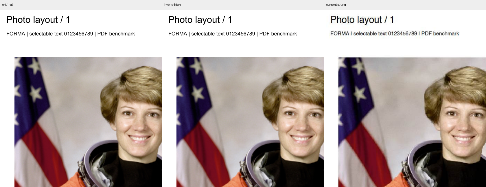
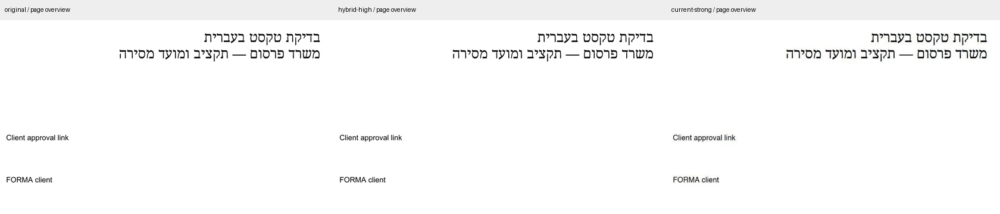
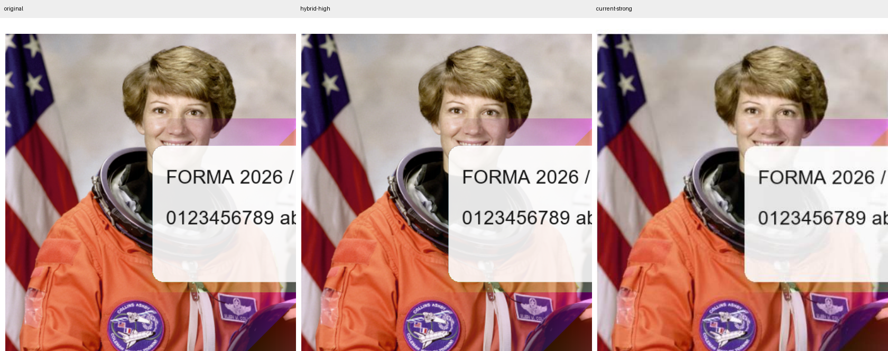

# השוואת מנועי דחיסת PDF

בדיקות מ־18 באוקטובר 2026; הדוח הושלם ב־19 באוקטובר 2026.

## מסקנה

אפשר לשפר את הדחיסה תוך שמירת טקסט לבחירה. הכיוון המוצלח ביותר במדגם היה שילוב של MuPDF לניקוי מבנה, כפילויות וגופנים, עם דחיסה נקודתית של תמונות ב־MozJPEG. הטקסט, הווקטורים, הקישורים והטפסים נשמרו בבדיקות. זהו מחקר ואב־טיפוס מבודד; מנוע ה־PDF באתר עדיין משתמש במימוש הקיים.

למוצר מומלצים שני מסלולים: מסלול ללא איבוד מידע, ומסלול חיסכון נוסף שמכווץ תמונות בלבד בהגדרת איכות שמרנית. במסלול השני התמונות עוברות דחיסה מאבדת מידע; הטקסט נשאר טקסט. יש להחזיר את המקור אם אין חיסכון.

## מה הושווה

- המנוע הקיים, כפי שהיה בקומיט `f431f68`: pdf-lib עם object streams במסלול העדין; רינדור עמודים ל־JPEG באיכות 0.68 וב־120 DPI במסלול החזק. הופעל בפועל דרך Chrome ו־PDF.js. העתק קפוא נמצא ב־`tests/pdf-benchmark/baseline.ts`.
- QPDF 12.4.2 ב־WASM: יצירת object streams ודחיסת Flate ברמה 9, עם ובלי אופטימיזציית תמונות באיכות 85.
- MuPDF.js 1.28.1: צמצום גופנים לגליפים שבשימוש, `garbage=4` להסרת כפילויות כולל streams, ודחיסה ללא שינוי בתמונות.
- `pdf-optimizer` בקומיט `bcca8ae`: טיפול בתמונות בלבד, דרך MuPDF 1.27.0 ו־MozJPEG. נבדקו איכויות 85 ו־97, דגימת צבע 4:4:4, ללא הקטנת רזולוציה וללא מחיקת פיקסלים שמחוץ לעמוד.
- מסלול משולב: אופטימיזציית תמונות באיכות 97, ולאחריה ניקוי וגופנים ב־MuPDF.js 1.28.1.

## תוצאות משקל

כל הערכים הם **בתים בפועל**. עמודת החיסכון משווה למנוע העדין הקיים, ולא לקובץ המקור. המסמכים כוללים 29 עמודים בסך הכול.

| מסמך | מקור | מנוע עדין קיים | QPDF ללא איבוד | MuPDF ללא איבוד | מסלול משולב | חיסכון נוסף מול הקיים |
| --- | ---: | ---: | ---: | ---: | ---: | ---: |
| שקיפות וגרפיקה | 910,730 | 909,168 | 907,479 | 908,821 | 255,441 | 71.90% |
| תמונות וגופנים חוזרים | 4,866,987 | 4,796,782 | 4,792,307 | 660,362 | 194,836 | 95.94% |
| עברית וטופס | 66,925 | 63,133 | 63,091 | 18,281 | 18,281 | 71.04% |
| תמונות RGB | 630,613 | 630,171 | 629,621 | 629,603 | 164,076 | 73.96% |
| תמונות עם פרופיל צבע | 633,124 | 632,627 | 632,072 | 632,055 | 166,528 | 73.68% |
| תמונה שכבר דחוסה ב־JPEG | 71,735 | 71,585 | 71,573 | 71,561 | 71,561 | 0.03% |
| תמונה עם שכבת OCR קיימת | 631,635 | 631,518 | 630,986 | 631,502 | 165,975 | 73.72% |
| טקסט וגרפיקה וקטורית | 30,507 | 27,824 | 27,276 | 9,868 | 9,868 | 64.53% |
| מאמר אמיתי, 14 עמודים | 1,016,315 | 962,726 | 866,294 | 857,338 | 857,338 | 10.95% |

החיסכון הגדול במסמך הכפילויות נובע גם מהסרת תמונות וגופנים זהים שהוטמעו כמה פעמים. זהו מקרה בדיקה מכוון, ואינו תחזית לחיסכון בכל PDF. בתמונה שכבר דחוסה היטב כמעט שאין חיסכון נוסף. רוב המדגם סינתטי ומבוקר; המאמר `tracemonkey` הוא מסמך אמיתי מתוך מאגר הבדיקות של Mozilla PDF.js.

## שימור איכות ותוכן

כל 29 עמודי המקור וכל עמודי הפלט רונדרו ב־Poppler ב־144 DPI, בנפרד מהמנועים שמבצעים את הדחיסה. נבדקו:

- טקסט מלא ומיקומי התווים, כולל עברית ושכבת OCR קיימת, באמצעות PyMuPDF.
- מידות עמודים, סיבוב, גאומטריית טקסט ומספר פעולות גרפיקה וקטורית.
- קישורים, סימניות, שדות טופס וערכיהם. בפלט הדפדפנים בוצע גם שינוי ערך בשדה ונבדק שהערך החדש נשמר בעץ השדות.
- זהות תוכן פרופילי ICC ומסכות השקיפות המפוענחות באמצעות pikepdf.
- השוואה פיקסל־לפיקסל במסלולים ללא איבוד מידע; הבדיקות עברו בכל תשעת המסמכים.
- במסלול המשולב, SSIM מרחבי מינימלי לכל עמוד היה לפחות 0.992497. המדד חושב ב־72 DPI מתוך רינדור 144 DPI, לצד השוואות ברזולוציה מלאה. SSIM אינו אחוז איכות ואינו הוכחה לזהות תמונה.

הטקסט, מיקומי התווים, הטפסים, הקישורים, הסימניות, הווקטורים, פרופילי הצבע ומסכות השקיפות נשמרו בכל החלופות המשמרות שבמדגם. המסלול החזק הקיים איבד טקסט לבחירה בשישה מסמכים. בשלושה אחרים הוא החזיר את המקור משום שהתוצאה הייתה גדולה יותר. לכן הוא אינו הפתרון לדרישה לשמור טקסט.

הגדרות התמונה הראשוניות 85 ו־95 לא עמדו ברף SSIM של 0.99 בתמונת עמוד מלא. נבחרה איכות 97 לאחר מדידה מחדש, ולא הורד רף הבדיקה כדי להעביר תוצאה חלשה יותר.

## בדיקות בדפדפנים

עברו 30 בדיקות: חמישה מסלולים, שני מסמכים, ובכל אחד Chrome, Firefox ו־WebKit. נבדקו QPDF, MuPDF, אופטימיזציית תמונות באיכות 85 ובאיכות 97, והמסלול המשולב. הטקסט נבדק גם באמצעות PDF.js בדפדפן; הפלטים נפתחו ונבדקו באופן עצמאי בפייתון וב־Poppler. המסלול המשולב עבר את רף האיכות גם בפלטי הדפדפנים.

[תוצאות הדפדפנים](pdf-candidate-browsers.json) · [כל המדידות, משקלים, זמני ריצה ו־hashes](pdf-compression-benchmark.json).

## השוואה חזותית

בוצעה בדיקה חזותית של התמונות הבאות. עמודות: מקור, מסלול משולב, מסלול חזק קיים. במסלול העדין הקיים התקבלה תמונה זהה למקור במדגם.







## התאמה לשילוב במוצר

**QPDF** מתאים למסלול שמרני של אופטימיזציה מבנית. הוא קטן יחסית כ־WASM, ורישיונו Apache-2.0. אופטימיזציית התמונות שלו עבדה בדוגמת DeviceRGB אך דילגה על תמונות ICCBased במדגם, ולכן אין להסתמך עליה לבדה למצגות עם תמונות. [תיעוד QPDF](https://qpdf.readthedocs.io/en/stable/cli.html).

**MuPDF** הפיק שיפור גדול במיוחד בכפילויות ובגופנים. חבילת JavaScript נושאת רישיון AGPL-3.0-or-later; יש להתייחס לרישיון המנוע בעת ההטמעה. [הפרויקט הרשמי](https://github.com/ArtifexSoftware/mupdf.js/) ו[תיעוד גופנים ושמירה](https://mupdf.readthedocs.io/en/latest/reference/javascript/types/PDFDocument.html).

**pdf-optimizer** הוא אב־טיפוס שימושי לגישה של החלפת תמונות בלבד. מעטפת הפרויקט היא MIT, אך הוא תלוי ב־MuPDF ברישיון AGPL. בעת הבדיקה החבילה לא הייתה זמינה ברישום npm ונבדקה מתוך קומיט קבוע. בבדיקת `npm audit` של עץ המחקר נמצאו חמש תלויות בחומרה גבוהה, כולל sharp ותלויות פיתוח של Vite. זה מחייב עדכון ובדיקה מחדש לפני אימוץ ישיר; תלויות אלה לא נוספו לאפליקציה. [קוד הפרויקט](https://github.com/mattdesl/pdf-optimizer).

**Ghostscript** נבדק ברמת התיעוד ולא נכלל במדידות. pdfwrite מפרש ובונה מסמך חדש, וחלק מסוגי המידע אינם נשמרים במלואם; נבחרו תחילה חלופות שמכוונות לשימור מבנה. [הסבר רשמי](https://ghostscript.readthedocs.io/en/latest/VectorDevices.html).

המלצת ההטמעה היא לממש worker מקומי עם שתי רמות: ללא איבוד מידע, וחיסכון נוסף בתמונות באיכות שמרנית. יש לשמור על בדיקות טקסט ותוכן, טיפול בכשלים, וסינון קבצים שכבר קטנים יותר. ההשוואה אינה מכסה כל PDF: חתימות דיגיטליות, PDF/A, קובצי דפוס CMYK מורכבים, טפסים מתקדמים וקבצים פגומים דורשים בדיקות נפרדות. הבדיקה אינה מוסיפה OCR למסמך שאין בו טקסט.

## שחזור

ההרצה מבודדת תחת `tmp/pdf-research` ואינה משנה תלויות של האתר. נדרשים Node.js 24, Python, Git, Poppler ודפדפני Playwright. מחולל המסמכים משתמש ב־Arial במחשב Windows; במערכות אחרות הוא משתמש ב־DejaVu Sans ולכן משקל המסמכים עשוי להשתנות. גם מזהי המסמכים עשויים להשתנות בין הרצות.

```sh
npm ci
npx playwright install chrome firefox webkit
node scripts/setup-pdf-benchmark.mjs
python -m pip install -r tests/pdf-benchmark/requirements.txt
python tests/pdf-benchmark/generate.py
node scripts/benchmark-pdf.mjs
python scripts/measure-pdf-compression.py
python scripts/audit-pdf-color-assets.py
node scripts/smoke-pdf-candidates.mjs
python scripts/audit-pdf-browser-results.py
```

`pdftoppm` צריך להיות ב־PATH. פרטי המקור והקומיטים נשמרים גם ב־`tmp/pdf-research/provenance.json`. תוצרי PDF והרינדורים נמצאים ב־`tmp/pdf-research/input`, `output`, `renders` ו־`browser-output`. לא נעשה שימוש במסמכי משתמש, בשירות עיבוד חיצוני או ביצירת מדיה בתשלום.
