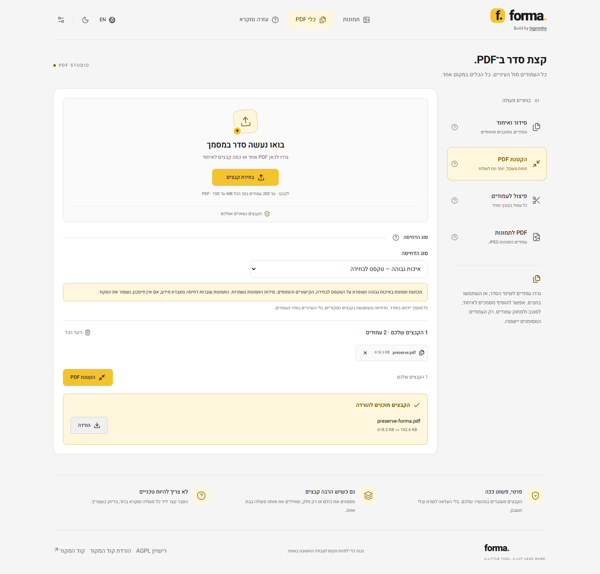

# מימוש דחיסת PDF - 19 באוקטובר 2026

מומש מנוע מקומי באמצעות `mupdf@1.28.1` הרשמי ו־MozJPEG מתוך `@jsquash/jpeg@1.6.0`. המימוש נמצא ב־`src/lib/pdf-compress.ts` ורץ ב־worker ייעודי. הוא אינו משתמש בחבילת pdf-optimizer או ב־sharp, ב־Vite הישן או בתלויות המחקר.

ברירת המחדל היא **איכות גבוהה - טקסט לבחירה**: החלפת תמונות צילום נתמכות ב־JPEG באיכות 97 וב־4:4:4, ללא שינוי מידות. טקסט וגרפיקה וקטורית אינם עוברים רינדור לתמונות. מסלול **ללא איבוד מידע** מנקה מבנה, כפילויות וגופנים בלבד. קובץ גדול יותר מוחלף במקור.

גופנים אינם מצומצמים במסמך שיש בו AcroForm, כדי לשמור על אפשרות להקליד תווים נוספים בטפסים בעתיד. לכן דוגמת הטופס חוסכת פחות מאב־הטיפוס. מסמכים עם ByteRange של חתימה דיגיטלית נדחים לפני שינוי. מסכות alpha ופרופילי ICC נשארים במקומם. CMYK, קידודים מורכבים, תמונות שכבר דחוסות ב־JPEG, נכסים קטנים ואיורים שטוחים נשארים ללא דחיסת JPEG נוספת.

לאחר השמירה המנוע פותח מחדש את התוצאה ובודק שהטקסט ומסגרות העמודים זהים. אם הבדיקה אינה עוברת, מוחזר המקור. בכשל טעינה או עיבוד מוצגת שגיאה שאפשר לנסות אחריה שוב; קובצי המקור נשארים ללא שינוי.

## קבצים שהורדו בפועל מהממשק

הטבלה מבוססת על הורדות Chrome של המימוש הסופי, ולא על מתאם המחקר. משקלים בבתים. החיסכון מול המנוע העדין הקודם, קומיט f431f68.

| דוגמה | מנוע קודם | מסלול ללא איבוד | איכות גבוהה | חיסכון נוסף | SSIM מינימלי באיכות גבוהה |
| --- | ---: | ---: | ---: | ---: | ---: |
| alpha-graphics | 909,168 | 908,821 | 255,461 | 71.90% | 0.998576 |
| duplicate-assets | 4,796,782 | 660,362 | 194,846 | 95.94% | 0.997536 |
| hebrew-form | 63,133 | 63,021 | 63,021 | 0.18% | 1.000000 |
| photo-device-rgb | 630,171 | 629,603 | 164,086 | 73.96% | 0.996655 |
| photo-flate | 632,627 | 632,055 | 166,538 | 73.68% | 0.996655 |
| photo-jpeg | 71,585 | 71,561 | 71,561 | 0.03% | 1.000000 |
| scan-ocr | 631,518 | 631,502 | 165,985 | 73.72% | 0.992497 |
| text-vectors | 27,824 | 9,868 | 9,868 | 64.53% | 1.000000 |
| tracemonkey | 962,726 | 857,338 | 857,338 | 10.95% | 1.000000 |



## אימות

53 תרחישים ב־Chrome, Firefox ו־WebKit (159 הרצות), כולל שימור תוכן בכל תשעת מסמכי הבדיקה בשני מסלולי הדחיסה, התאוששות מכשל הורדת WASM ודחיית חתימה דיגיטלית. בדיקות קודמות של תמונות, PDF, מובייל, שפות ונגישות נשארו בחבילה. בנוסף 14 בדיקות יחידה.

`python scripts/check-pdf-production.py` מבצע אימות נפרד של 18 פלטים: טקסט, מיקומי תווים, מידות וסיבוב עמודים, קישורים, שדות וערכי טופס, סימניות, מספר פעולות וקטוריות, תוכן פרופילי ICC ומסכות alpha. הוא גם בודק תקינות תחביר באמצעות QPDF שב־pikepdf ורינדור Poppler מלא ב־144 DPI. נדרשת זהות פיקסלים במסלול ללא איבוד מידע ו־SSIM של לפחות 0.99 במסלול האיכות הגבוהה. הנתונים המלאים ב־[pdf-production-validation.json](pdf-production-validation.json).

בדיקת production מפעילה גם את MuPDF והמקודד ב־worker שנבנה לנתיב `/FORMA-TOOL/`, מורידה תוצאה אמיתית, מאשרת חיסכון וקיום גופנים, פותחת אותה מחדש, ובודקת שאין שגיאות ריצה או בקשות שנכשלו. היא בודקת גם את הורדת הרישיון, ארכיון קוד המקור וארכיון מקור MuPDF.

## רישיונות ותלויות

הפרויקט ברישיון AGPL-3.0-or-later. בתחתית האתר קיימים קישור לרישיון, הורדת מקור האפליקציה וקישור למאגר. קוד מקור MuPDF המלא, כולל תלויות מקור וכלי בניית WASM, מסופק עם האתר. מסופקים גם מקור MozJPEG, קוד jSquash והוראות בנייה. [פירוט](../SOURCE.md).

נוספה תלות production אחת: MuPDF הרשמי. גרסאות מנועי ה־WASM מוצמדות וה־lockfile מעודכן. `npm audit` לאחר ההתקנה מצא אפס חולשות. התלויות הפגיעות של אב־טיפוס המחקר אינן חלק מהיישום.

## הרצה

```sh
npm ci
npm test
npx playwright install chrome firefox webkit
npm run test:browsers
python -m pip install -r tests/pdf-benchmark/requirements.txt
python scripts/check-pdf-production.py
npm run build
npm run test:production
```

לאימות הרינדור נדרש Poppler ב־PATH. ה־CI מריץ את בדיקות Chrome ואת האימות העצמאי לפני הפרסום. בדיקת שלושת הדפדפנים נתמכת מקומית. תוצאות אלה מתייחסות למדגם המתועד; אינן הבטחה לחיסכון קבוע בכל PDF ואינן כוללות כל סוג מסמך או מכשיר.
